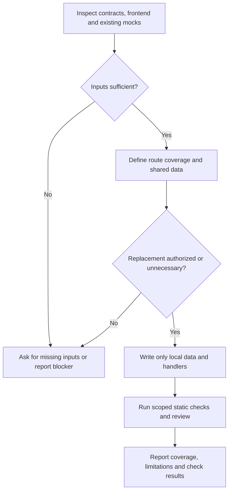

# Frontend Mocks

Produce a small, coherent local API simulation, not a second backend.
Paths beginning with `app/` are relative to the project root.

## Inputs

- **Scope**: requested screens or journeys; default to API calls used by the current frontend, including shared authentication and dependent resources.
- **Contract**: `app/api/openapi.override.json` when present, otherwise the source configured by `OPENAPI_URL` and `orval.config.ts`.
- **Generated APIs**: existing clients, hooks, types and Zod schemas under `app/api/generated/`.
- **Business rules**: project instructions, explicit requirements and existing frontend behavior.
- **Scenario**: optional dataset and exceptional states; default to a small realistic dataset with successful actions.

## Flow

### 1. Establish the expected API

- Read project instructions, Orval configuration, MSW setup and existing local mocks before editing.
- Inspect relevant routes, containers, hooks and generated calls; include calls triggered after mutations, invalidations and navigation.
- Identify browser/server request boundaries; flag journeys that require shared state across runtimes instead of pretending separate in-memory stores are shared.
- Read the matching OpenAPI operations and schemas for methods, URLs, parameters, request bodies, response envelopes, status codes and errors.
- Resolve identifiers, relationships, permissions, transition rules, counters and concurrency requirements from explicit sources, not sample values alone.
- Stop on missing contracts, missing or stale generated APIs, conflicting requirements or essential unknown behavior; ask for clarification instead of modifying contracts or inventing rules.
- If generation is required, ask the user to run the existing API synchronization command first.
- Present the intended route coverage, scenario, assumptions and estimated net line diff before writing.
- Preserve existing local data and handlers; ask before replacing the dataset, removing routes or changing unrelated scenarios.

### 2. Define stable shared data

- Create `app/api/mocks.local/index.ts` as the default-exported handler array, typed with `satisfies HttpHandler[]` from MSW.
- Keep seed data and mutable state in `data.ts`, handlers in `handlers.ts`, and split by resource only when necessary.
- Import generated types and schemas directly; do not copy DTOs, write alternative API contracts or depend on response factories.
- Write fixed synthetic records with stable unique identifiers and fixed initial dates; never use Faker, random values or request-time seed generation.
- Use one shared record for each entity and reference it consistently across list, detail, association and mutation responses.
- Derive counts, metrics and pagination metadata from the shared records and the contract's filtering semantics.
- Include representative populated and empty resources, optional fields, and relevant relationships without creating an exhaustive dataset.
- Use invented identities and safe example URLs; never copy personal data, credentials, tokens or production records.
- Initialize state once per module lifecycle; requests reuse it, while a full reload restores the same seed data.
- Do not introduce persistence, a database, new dependencies or a generic CRUD framework unless separately requested.

### 3. Implement coherent handlers

- Use the installed MSW HTTP APIs and generated URL helpers where applicable; match the configured API origin or path prefix without intercepting unrelated traffic.
- Read GET responses from shared state and honor the actual filters, sorting and pagination used by the frontend.
- Parse mutation bodies with generated request types and available schemas; enforce documented constraints before modifying state.
- Make successful mutations update the records returned by subsequent reads, including documented associations, revisions and derived metrics.
- Return the contract's response envelope, content type, status code and error shape; preserve no-content responses and binary responses where required.
- Return documented not-found, validation and conflict errors when their conditions hold; do not return success for unsupported behavior.
- Make the default authenticated identity and authorization scenario consistent across every relevant route.
- Keep action failures, empty states and delays explicit and opt-in; never alternate outcomes or randomly expire authentication.
- Add any requested failure switch in the local modules, not in application code or generated clients.
- Define explicit unsupported-mock handling for the covered API namespace so missing API handlers cannot silently reach a real backend; leave assets, development tooling and unrelated origins unaffected.
- Report unsupported streaming, uploads or other operations instead of returning unrelated JSON or pretending they succeeded.

### 4. Validate and hand off

- Immediately after implementation, invoke `diff-check` when available; otherwise perform the scoped static checks and review below without expanding the authorized output directory.
- Inspect existing scripts and run eligible lint, formatting and typechecks that include the ignored TypeScript files; use scoped equivalents if a script skips them.
- Do not create or run tests, simulations or builds, and do not launch the mock-generation command recursively.
- Review route matching, shared identifiers, mutation/read consistency, reset behavior and error shapes against the contract and frontend usages.
- Confirm all authored files stay under `app/api/mocks.local/` and remain Git-ignored; do not stage or force-add them.
- Fix static-check failures within that directory; report external blockers without editing unrelated files.
- Report covered methods and paths, available scenario switches, reset behavior, unresolved assumptions and actual check results.
- State that static checks do not establish real-backend correctness or browser behavior.

## Authorization

- Author only files under `app/api/mocks.local/`; never modify application code, generated APIs, OpenAPI, dependencies, shared configuration or instructions.
- Do not call the real application backend, start an AI process at application runtime or regenerate mocks on startup.
- Treat these output restrictions as workflow rules, not a filesystem sandbox; honor any stricter tool permissions.
